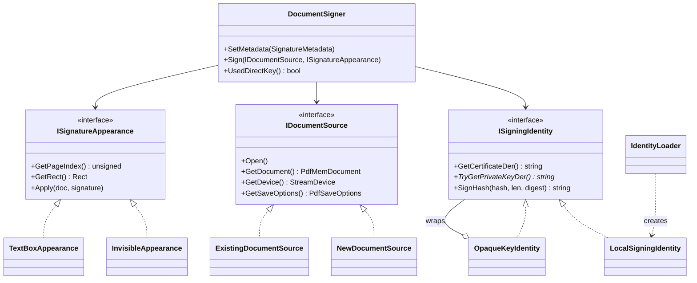

# podofo-pdf-sign

A worked example of digitally signing a PDF with [PoDoFo](https://github.com/podofo/podofo) 1.1.x.

It covers the parts that are actually fiddly: getting signing credentials out of
the formats they arrive in, placing a signature field, signing an existing
document without invalidating signatures already on it, and delegating the
private-key operation to something outside the process.

## Why it pins PoDoFo 1.1.2

Debian, Ubuntu and Kali still package **PoDoFo 0.9.8**. Its signing API is
entirely different — `PdfSignOutputDevice` plus hand-rolled OpenSSL PKCS#7 — and
is gone from current upstream. The modern API used here (`PdfSignerCms`,
`PoDoFo::SignDocument`) arrived in 0.10 and settled in 1.x, so
`scripts/build-podofo.sh` fetches and builds 1.1.2 into `third_party/prefix`
rather than using the distro package.

## Build

```bash
scripts/install-deps.sh      # the only step needing root
scripts/build-podofo.sh      # PoDoFo 1.1.2 -> third_party/prefix
cmake -S . -B build && cmake --build build
```

Requires CMake ≥ 3.23, a C++17 compiler, OpenSSL and **libcurl** (the RFC 3161
client uses it to reach a timestamp authority). If your distro's CMake is older,
`pipx install cmake` gives a current one without root.

If you cannot use `sudo`, the dependencies can be staged locally instead:
`apt-get download <pkg>` needs no privileges, `dpkg-deb -x` unpacks each into a
sysroot, and CMake is pointed at it with `-DCMAKE_PREFIX_PATH`. One wrinkle if
you go that way: `openssl/opensslconf.h` lives in the architecture-specific
`include/<triplet>/openssl/` directory, so that directory has to be merged into
the main `include/openssl/` or PoDoFo's build will not find it.

Note that `CMakeLists.txt` calls `find_package(PoDoFo REQUIRED)` with no version
argument. Upstream's README suggests `find_package(PoDoFo 1.0.0 REQUIRED)`, but
PoDoFo's package version file uses *SameMinorVersion* compatibility, so that
call is rejected by 1.1.2 for being a different minor release. The version is
checked after the fact instead.

## Run

```bash
scripts/demo.sh
```

That generates a throwaway certificate and exercises every mode. For individual
runs:

```bash
# Generate a sample page and sign it invisibly
build/podofo-pdf-sign sign --pkcs12 test-cert.p12 --password test --out signed.pdf

# Sign an existing document with a visible appearance
build/podofo-pdf-sign sign \
    --cert cert.pem --key key.pem \
    --in contract.pdf --out contract-signed.pdf \
    --visible --rect 56,80,240,80 \
    --reason "Approved" --location "Bucharest, RO"

# Inspect credentials without signing anything
build/podofo-pdf-sign info --pkcs12 test-cert.p12 --password test
```

`--help` lists every option.

## Front ends

The signing engine is a library (`pdfsign_core`) with a single entry point for
user interfaces, `SigningFacade`. Two front ends drive it:

- **`podofo-pdf-sign`** — the command line, documented below.
- **`winui/`** — a Windows 10/11 desktop window in WinUI 3, laid out after the
  clickSIGN PDF dialog. See [winui/README.md](winui/README.md). It was written
  but, being developed on Linux, has never been compiled by MSVC.

`SigningFacade.h` includes only `<string>`, `<vector>` and `<functional>`: no
PoDoFo, OpenSSL or libcurl type crosses it, and neither does an exception.
Failures come back as data, because a UI has no good way to catch an exception
thrown on a worker thread.

The WinUI view model is plain C++ with no Windows dependency, and is built on
Linux as `pdfsign_viewmodel` precisely so that presentation logic cannot
quietly become Windows-only.

## Architecture

Three things vary independently when you sign a PDF: where the document comes
from, whether the signature is visible, and whether the private key can leave
its holder. Each is an interface, and `DocumentSigner` collaborates with all
three without testing which kind it was given. `main.cpp` is the composition
root, and is the only place that branches on user options.



Each abstraction exists because it removes a conditional, not for its own sake.

**`ISigningIdentity`** — the certificate plus the ability to sign with its key.
`TryGetPrivateKeyDer()` returns `nullptr` when the key cannot be handed over,
which pushes the caller onto `SignHash()`. `LocalSigningIdentity` holds a key
read from a file; `OpaqueKeyIdentity` is a decorator that reports the key as
unavailable while delegating everything else. That one wrapper is the whole of
`--external-key`: it makes an ordinary key file behave like an HSM, and the
signer never learns the difference.

**`IDocumentSource`** — the document and the stream its bytes are written to,
which travel together because they are not independent. `NewDocumentSource`
creates a document in memory and writes it with `SaveOnSigning`.
`ExistingDocumentSource` copies the input, reopens the copy read-write and uses
`NoMetadataUpdate`:

| | stream | save options |
|---|---|---|
| `NewDocumentSource` | `FileStreamDevice(out, FileMode::Create)` | `SaveOnSigning` |
| `ExistingDocumentSource` | copy input → output, then `FileStreamDevice(out, FileMode::Open)` | `NoMetadataUpdate` |

Signing an existing PDF is an **incremental update**: the original bytes are
left untouched and a new revision is appended. That is what keeps any signature
already on the document valid, and it is why the output must start as a
byte-for-byte copy of the input and be opened read-write. `NoMetadataUpdate`
matters for the same reason — refreshing `/ModDate` would rewrite bytes covered
by the earlier signature's byte range and break it. Step 4 of `demo.sh` signs an
already-signed file to show this working.

**`ISignatureAppearance`** — where the widget sits and what it draws. An
invisible signature protects the document just as fully, so it is a real class
rather than a flag: `InvisibleAppearance` returns a zero-sized rectangle and
draws nothing. `TextBoxAppearance` **owns** the form XObject it creates, which
is load-bearing — the widget references that object, so it has to outlive the
call to `SignDocument`. Ownership by the appearance makes that automatic.

**`IdentityLoader`** normalises what is on disk into what PoDoFo wants. The
library needs DER: an X.509 certificate and a private key. Real credentials
arrive as PEM, as DER, or as a password-protected PKCS#12 bundle. Formats are
detected by content, not by file extension, and `LocalSigningIdentity` checks
the key against the certificate in its constructor — a mismatch otherwise
yields a well-formed signature that every validator rejects.

### The signing sequence

`DocumentSigner::Sign` is short because the variation lives elsewhere:

1. `source.Open()` — prepare the document and its read-write stream.
2. Create a `PdfSignature` field on `appearance.GetPageIndex()` using
   `appearance.GetRect()`.
3. Write the metadata, then `appearance.Apply()`.
4. Ask the identity for its key. If it has one, hand it to `PdfSignerCms`;
   otherwise install a `SigningService` callback that routes the document hash
   back through `identity.SignHash()`.
5. `PoDoFo::SignDocument`, which reserves a placeholder, computes the byte
   ranges, hashes everything outside the placeholder, builds the detached CMS
   blob and writes it back into the gap.

Only step 4 branches, and it branches on a question the identity answers about
itself rather than on a mode the caller passed down.

## Long-term validation (PAdES B-LT / B-LTA)

A signature that merely verifies today is not enough for an archive: the
responder that vouched for the certificate will be switched off, and the
certificate itself will expire. PAdES answers that in two further revisions.

```bash
podofo-pdf-sign lta --pkcs12 test-cert.p12 --password test \
    --tsa-cert tsa-cert.pem --tsa-key tsa-key.pem --out lta.pdf --visible
```

That writes three files, one per level, so they can be compared:

| Revision | Level | What is added |
|---|---|---|
| `lta.b.pdf` | B-B | the signature |
| `lta.lt.pdf` | B-LT | `/DSS` holding the certificate and an OCSP response |
| `lta.pdf` | B-LTA | a `/DocTimeStamp` over everything above |

The steps also exist separately as `add-validation` and `add-timestamp`, so an
already-signed document can be upgraded later.

### How much does PoDoFo give you?

**Nothing, directly — and that turned out not to matter.** PoDoFo 1.1.2 has no
concept of a DSS, of revocation data, or of a document timestamp. What it does
have are the two primitives those are built from, and both are public API.

**Step 2 leans on `SaveUpdate`.** The DSS is ordinary PDF structure, so it is
assembled straight from the object model in
[ValidationDataStore.cpp](src/ValidationDataStore.cpp) — a stream object per
blob, arrays of references to them, hung off `/DSS` in the catalog — and then
`PdfMemDocument::SaveUpdate` writes it as an incremental revision. No signing
involved, and the existing signature keeps covering exactly the bytes it did
before.

One trap: an array must already be **attached to the document** before indirect
references can be added to it. `PdfDataContainer::IsIndirectReferenceAllowed`
checks that the container has an owner so it can confirm both sides live in the
same document, so building a detached `PdfArray` and inserting it afterwards
fails with "Given object shall allow indirect insertion". Insert the empty
array into the dictionary first, then fill the attached copy.

**Step 3 subclasses `PdfSigner`.** This is the part that could have been a
dead end and was not. `PdfSigner` is abstract with `GetSignatureSubFilter()`
and `GetSignatureType()` pure virtual, so a document timestamp is just another
implementation — see
[DocumentTimestamp.cpp](src/DocumentTimestamp.cpp):

```cpp
std::string GetSignatureFilter()    const override { return "Adobe.PPKLite"; }
std::string GetSignatureSubFilter() const override { return "ETSI.RFC3161"; }
std::string GetSignatureType()      const override { return "DocTimeStamp"; }
```

`AppendData` hashes the byte ranges and `ComputeSignature` returns an RFC 3161
token instead of a CMS blob. Everything else — placeholder reservation, byte
range computation, the incremental revision — is the same machinery that signs
a normal signature. PoDoFo writes the dictionary as exactly
`/Type /DocTimeStamp /ByteRange /Contents /Filter /SubFilter`, with none of the
signer metadata an ordinary signature carries, which is what ETSI requires.

The one wrinkle is sizing. PoDoFo fixes the `/Contents` placeholder from a dry
run, but the real token is computed over a different digest and can differ by a
few bytes, so `DocumentTimestampSigner` reserves 2 KB of slack during the dry
run and zero-pads the real token into it.

**Effort:** roughly 400 lines, of which about 250 are OpenSSL (building the
OCSP response and driving `TS_RESP_CTX`) and only about 150 are PoDoFo. The
library was not the hard part; the PKI was.

### Getting the timestamp from a real authority

The timestamp is **fetched from a trust service provider over the network and
applied to the PDF locally**. Only a digest leaves the machine — the request
carries the hash of the document's byte ranges and nothing else — which is what
makes handing timestamping to a third party acceptable in the first place.

```bash
# Plain HTTP, which is normal for RFC 3161: the token is signed, and the
# request reveals only a hash.
podofo-pdf-sign add-timestamp --tsa-url http://timestamp.digicert.com \
    --in lt.pdf --out lta.pdf

# HTTPS
podofo-pdf-sign add-timestamp --tsa-url https://freetsa.org/tsr \
    --in lt.pdf --out lta.pdf

# Mutual TLS, for a provider that identifies subscribers by certificate
podofo-pdf-sign add-timestamp --tsa-url https://tsa.example.com/tsr \
    --tsa-client-cert client.pem --tsa-client-key client.key \
    --tsa-client-key-pass secret \
    --tsa-ca provider-ca.pem \
    --in lt.pdf --out lta.pdf

# HTTP basic auth, for a provider that uses an account instead
podofo-pdf-sign add-timestamp --tsa-url https://tsa.example.com/tsr \
    --tsa-user alice --tsa-pass secret --in lt.pdf --out lta.pdf
```

[HttpTimestampService](src/HttpTimestampService.cpp) builds the RFC 3161
request, POSTs it as `application/timestamp-query`, and checks the reply before
accepting it. libcurl carries the transport, which is what makes mutual TLS
four options (`CURLOPT_SSLCERT`, `CURLOPT_SSLKEY`, `CURLOPT_KEYPASSWD`,
`CURLOPT_CAINFO`) rather than a pile of hand-rolled `SSL_CTX` and BIO work.

Two checks matter and are easy to leave out:

- **The nonce must come back unchanged.** A fresh 64-bit nonce goes out with
  every request. Without checking it there is nothing tying the token received
  to the request sent, so a token captured earlier could be replayed.
- **The returned message imprint must be the digest we asked about**, in case
  the authority answers about something else.

`--tsa-insecure` disables TLS verification. It exists only so a provider with a
private CA can be tried before its root is installed; it makes the transport
meaningless and the tool says so in its own output.

#### One request, not two

PoDoFo hashes the document **twice**: once in a dry run to size the `/Contents`
placeholder, once for real. Asking a remote authority both times would double
the requests to a service that may be metered or rate-limited — and the dry
run's digest is not the one the final token covers anyway, so the first token
would be useless.

That cost difference is on the interface rather than buried in the client:

```cpp
/** Whether obtaining a token is cheap enough to do speculatively. */
virtual bool IsLocal() const = 0;
```

A local authority returns `true` and is asked twice, which sizes the
placeholder exactly. A remote one returns `false`, so
`DocumentTimestampSigner` reserves a fixed `--ts-reserve` (16 KB by default,
against real tokens of 3–7 KB) and contacts the provider **once**. If the token
will not fit, the error says which number to raise.

### Testing mutual TLS without a provider

`scripts/mock-tsa-server.py` is a local RFC 3161 authority over HTTPS that can
require a client certificate, so the mutual-TLS path can be exercised offline:

```bash
python3 scripts/mock-tsa-server.py --port 8443 \
    --tsa-cert tsa-cert.pem --tsa-key tsa-key.pem \
    --server-cert tsa-server-cert.pem --server-key tsa-server-key.pem \
    --client-ca client-cert.pem          # omit to allow anonymous clients
```

`scripts/make-test-cert.sh` issues everything it needs: a TSA signing
certificate, a TLS server certificate for `localhost`, and a client
certificate. Step 8 of `demo.sh` runs it both ways and shows the request being
refused at the TLS handshake when no client certificate is presented.

Note that the TSA's **signing** certificate and its **TLS** certificate are
different things: one signs tokens and needs a critical
`id-kp-timeStamping` extended key usage, the other secures the transport and
needs `serverAuth`. OpenSSL checks `X509_PURPOSE_TIMESTAMP_SIGN` when signing
and refuses a certificate without that EKU, so the two cannot be the same file.

### Getting revocation data from a real responder

`--ocsp` points step 2 at a real OCSP responder. The request goes out as
`application/ocsp-request` and the reply comes back as
`application/ocsp-response`, per RFC 6960.

```bash
# Ask a responder directly
podofo-pdf-sign add-validation --ocsp http://ocsp.certsign.ro \
    --cert signer.pem --issuer ca.pem --in s.pdf --out lt.pdf

# Or let each certificate name its own responder
podofo-pdf-sign add-validation --ocsp-aia \
    --cert signer.pem --issuer ca.pem --in s.pdf --out lt.pdf

# Mutual TLS and HTTP basic auth work exactly as they do for the TSA
podofo-pdf-sign add-validation --ocsp https://ocsp.example.com \
    --ocsp-client-cert client.pem --ocsp-client-key client.key \
    --ocsp-ca provider-ca.pem --cert signer.pem --issuer ca.pem \
    --in s.pdf --out lt.pdf
```

Without `--ocsp` the in-process mock is used, so the tool still works offline.

**`--issuer` is required for any certificate that is not self-signed.** The
OCSP CertID is built from the issuer's name and public key, so a request made
with the wrong issuer asks about a certificate nobody has heard of. The
responder answers `unknown` rather than failing, which is why the tool warns
loudly when it sees that status — a silent `unknown` in the DSS is worse than
an error.

The whole DER response is stored in `/DSS`, not just the status: a validator
years from now re-checks that signed response rather than contacting a
responder that may no longer exist.

#### Two things real responders do that a mock does not

- **Pre-produced responses carry no nonce.** A nonce goes out with every
  request, but responders that sign in advance and serve from a cache return
  responses without one — Sectigo's are typically a day or two old. Only a
  nonce that is *present and different* means the reply is not ours; a missing
  one is normal and is reported rather than rejected.

  The nonces are compared directly rather than through `OCSP_check_nonce`,
  whose return codes are documented inconsistently: "nonce in request only"
  came back as `-1` here, the same code as a genuine mismatch. Conflating the
  two rejects every caching responder.

- **Validity windows are checked** with five minutes of tolerance, so a
  skewed clock produces a clear error rather than a response a validator will
  later reject.

Tested against `ocsp.certsign.ro` (echoes the nonce) and `ocsp.sectigo.com`
(pre-produced, no nonce). The response embedded in the PDF passes
`openssl ocsp -respin ... -VAfile` against the issuing chain.

### Shared transport

Both clients POST a DER request and read a DER response, so the HTTP, TLS,
mutual-authentication and timeout handling lives once in
[HttpClient.cpp](src/HttpClient.cpp) and the protocol clients only build and
parse their own messages. The `--tsa-*` and `--ocsp-*` option groups are the
same settings parsed against two prefixes.

### What is still missing for strict conformance

- **Only OCSP, no CRL fallback.** A responder that is down or that does not
  cover the issuing CA leaves the DSS without revocation data; a production
  tool would fall back to the CRL distribution point.
- **No signature timestamp, so this is B-LT/B-LTA built on B-B, not on B-T.**
  A fully conformant chain is B-B → B-T → B-LT → B-LTA, where B-T adds an RFC
  3161 token over the signature value as an unsigned CMS attribute.
  `PdfSignerCms::SetTrustedTimestamp` exists on PoDoFo master but **not in
  1.1.2**. `AddAttribute` is there and could carry the token, but it has to be
  called before signing, and the token can only be fetched once the signature
  value exists — the deferred `FetchIntermediateResult` /
  `ComputeSignatureDeferred` pair is the intended way out of that ordering
  problem.
- **No `/VRI`.** See the note in `ValidationDataStore::Commit` — PDF 2.0
  deprecates it and the specifications disagree over whether its key digests
  `/Contents` with or without PoDoFo's zero padding.
- **The certificate to vouch for is supplied, not extracted.** A production
  tool would parse the signer certificate out of the signature's CMS blob
  rather than being handed it on the command line.
- **`pdfsig` does not understand document timestamps.** It reports the
  `/DocTimeStamp` field as "Signature has not yet been verified" with an
  unknown hash algorithm. That is a poppler limitation, not a defect in the
  output: `openssl ts -verify` accepts the same token, and
  `scripts/verify-signatures.py` confirms its message imprint equals the
  SHA-256 of the bytes it covers.

## Verifying the output

`scripts/verify-signatures.py` checks every signature in a file without
trusting anything the producer says: it reads each `/ByteRange`, reassembles
exactly the bytes that signature covers, and hands the detached CMS blob to
OpenSSL.

```console
$ scripts/verify-signatures.py out/*.pdf
  sample-countersigned.pdf: 2 signature(s)
    sig 1: VALID    covers_to_eof=False cms=1966B
    sig 2: VALID    covers_to_eof=True cms=1966B
  sample-visible.pdf: 1 signature(s)
    sig 1: VALID    covers_to_eof=True cms=1966B
```

`covers_to_eof=False` on the first signature of the countersigned file is the
incremental update working: signature 1 covers the original revision, signature
2 covers everything including it, and both still verify.

`pdfsig` from poppler-utils is a good second opinion:

```console
$ pdfsig out/sample-countersigned.pdf
  Signature #1:
    - Signing Hash Algorithm: SHA-256
    - Signature Type: ETSI.CAdES.detached
    - Signed Ranges: [0 - 2564], [6498 - 17345]
    - Not total document signed
    - Signature Validation: Signature is Valid.
    - Certificate Validation: Unknown issue with Certificate or corrupted data.
```

"Signature is Valid" with a certificate complaint is the expected result for a
self-signed test certificate: the maths is right, the trust chain is not there.

## Limitations

These are deliberate, and each one matters if you take this further:

- **A self-signed test certificate validates nowhere.** It chains to nothing, so
  Acrobat reports "signature validity is unknown" rather than a green check.
  That is the correct result, not a bug in the example.
- **No certificate chain is embedded.** PoDoFo 1.1.2 exposes no public API for
  adding intermediates to the CMS structure; `PdfSignerCms` takes the signer
  certificate only. Bundled chain certificates are reported by `info` but not
  written. Validators then have to build the chain themselves, which they often
  cannot do.
- **The plain `sign` command produces B-B only.** See the long-term validation
  section above for `add-validation`, `add-timestamp` and `lta`, and for what
  is still missing from strict LTA conformance.
- **The signature field is always created fresh.** Signing into a pre-existing
  empty signature field in a prepared form is a different code path and is not
  handled here.

## Layout

```
src/SigningIdentity.{h,cpp}      ISigningIdentity, LocalSigningIdentity,
                                 OpaqueKeyIdentity, IdentityLoader
src/DocumentSource.{h,cpp}       IDocumentSource and its two implementations
src/SignatureAppearance.{h,cpp}  ISignatureAppearance, invisible and text-box
src/DocumentSigner.{h,cpp}       SignatureMetadata and the orchestrator
src/SignatureField.{h,cpp}       field creation, shared by signer and timestamper
src/ValidationServices.{h,cpp}   IOcspResponder / ITimestampService + mocks
src/ValidationDataStore.{h,cpp}  the /DSS writer and the B-LT upgrade
src/DocumentTimestamp.{h,cpp}    /DocTimeStamp PdfSigner and its orchestrator
src/HttpClient.{h,cpp}           shared HTTP/TLS transport for both clients
src/HttpTimestampService.{h,cpp} RFC 3161 client over HTTP/HTTPS, mutual TLS
src/HttpOcspResponder.{h,cpp}    RFC 6960 OCSP client, AIA discovery
src/OpenSslSupport.{h,cpp}       OpenSSL RAII handles and error reporting
src/SampleDoc.{h,cpp}            generates a page to sign when no input is given
src/SigningFacade.{h,cpp}        the UI-facing boundary: plain types, no throw
src/main.cpp                     command line and composition root
winui/ViewModel/                 portable presentation logic (built on Linux too)
winui/ClickSignPdf/              WinUI 3 XAML window and its adapter
scripts/install-deps.sh  system build dependencies (needs root)
scripts/build-podofo.sh  builds PoDoFo 1.1.2 into third_party/prefix
scripts/make-test-cert.sh    throwaway self-signed signing certificate
scripts/demo.sh              end-to-end run of every mode
scripts/mock-tsa-server.py   local HTTPS TSA for exercising mutual TLS
scripts/verify-signatures.py independent OpenSSL check of a signed PDF
```

## License

MIT.
